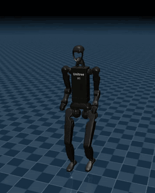
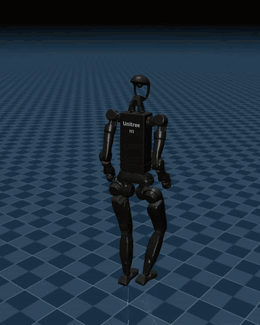
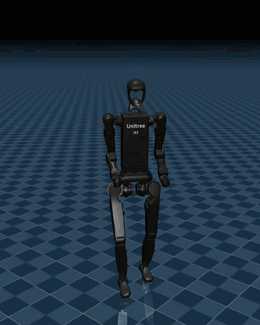

# biped_hrl: Hierarchical RL for Unitree H1-2 Locomotion

A framework for training, benchmarking and deploying velocity-tracking locomotion policies on the
Unitree H1-2 humanoid, built for a master's thesis that compares a flat PPO policy against
hierarchical reinforcement learning (HRL) architectures for sim-to-real transfer. The thesis is
submitted; the code is kept usable as a starting point for follow-up projects.

Forked from [unitreerobotics/unitree_rl_mjlab](https://github.com/unitreerobotics/unitree_rl_mjlab),
which provides the [mjlab](https://github.com/mujocolab/mjlab.git) training scaffold (Isaac-Lab-style
API on MuJoCo / MuJoCo-Warp), PPO via [rsl_rl](https://github.com/leggedrobotics/rsl_rl.git) and a
C++ sim2real deploy pipeline. Everything H1-2-specific beyond the upstream flat baseline (the
retuned actuator model, the hierarchy, the evaluation probes, the deploy and telemetry stack) is
this project's work.

<div align="center">

| Flat (A0) | Hierarchical (A1a) | Hierarchical + DR |
|---|---|---|
|  |  |  |

The three report policies walking at 0.5 m/s in the MuJoCo deployment simulator, 5 s from the
same stage of the bridge command schedule.

</div>

## Status

| Arch | Task ID | Idea | Status |
|---|---|---|---|
| **A0** | `Unitree-H1_2-Flat` | Flat PPO baseline | Trained, runs on the real robot |
| **A1 / A1a** | `Unitree-H1_2-Flat-A1` | HIRO hierarchy: PPO low level, TD3 high level emitting velocity goals and a stride period every `c = 8` steps, rewarded on tracking minus cost of transport | Trained, runs on the real robot; **A1a is the deployed policy** |
| H-adapt | `Unitree-H1_2-Flat-A1-Payload` + `hl_obs_e` | A1a whose high level reads environment extrinsics, estimated on the robot by an adaptation encoder | Built and exported; did not meet its payload bar ([ADR-0011](docs/adr/0011-record-bar-b-as-failed.md)) |
| A2 | not registered | A1 + RMA-style latent adaptation on the low level | Spec only ([`doc/hrl/A2_ARMA.md`](doc/hrl/A2_ARMA.md)) |
| A3 / A4 | not registered | Gait library + residual / trajectory + MPC | Not started |

Policy names used in the docs: **A0** (flat), **A1a** (the frozen hierarchical keeper,
`logs/rsl_rl/h1_2_velocity_a1_v2/2026-09-02_12-57-09_a1a_fullmirror_cot5_standing12_s42/model_10000.pt`),
**A0_DR / A1a_DR** (the same with coupled payload domain randomization). The full dashboard is
[`doc/hrl/HRL_plan.md`](doc/hrl/HRL_plan.md); why A1a stays the deploy policy is
[ADR-0013](docs/adr/0013-keep-a1a-as-the-deploy-policy.md).

## Quick start

Install the conda environment and mjlab / MuJoCo-Warp following [`doc/setup_en.md`](doc/setup_en.md).
The environment used throughout is `unitree_mjlab_h1_2_rl`.

```bash
conda activate unitree_mjlab_h1_2_rl

# train (launch with python directly, not `conda run`: it buffers stdout and breaks live W&B)
python scripts/train.py Unitree-H1_2-Flat    --env.scene.num-envs 4096 --agent.max-iterations 10001 --agent.run-name a0
python scripts/train.py Unitree-H1_2-Flat-A1 --env.scene.num-envs 4096 --agent.max-iterations 10001 --agent.run-name a1a

# watch a policy
python scripts/play.py Unitree-H1_2-Flat-A1 --checkpoint-file <run>/model_10000.pt --num-envs 1

# benchmark it (the canonical comparison)
python scripts/play.py Unitree-H1_2-Flat-A1 --checkpoint-file <run>/model_10000.pt \
    --num-envs 64 --eval-steps 600 --eval-seeds 2

# export ONNX for deployment
python scripts/play.py Unitree-H1_2-Flat-A1 --checkpoint-file <run>/model_10000.pt --export-onnx
```

- Ask for `N+1` iterations (`10001`): checkpoints are named after the last iteration index, so
  `10000` ends at `model_9999.pt`.
- Resume with `--agent.resume True --agent.load-run <dir> --agent.load-checkpoint model_<it>.pt`;
  `--agent.max-iterations` then counts additional iterations.
- The bare A1 task trains the full A1a structure (TD3 high level, tracking reward, cadence
  channel). Set `--agent.hl-algorithm oracle` for a fixed high level that isolates the low level.
- Logs go to `logs/rsl_rl/<experiment>/<date>_<run-name>/`, W&B project `biped_hrl`.

## Task IDs (H1-2)

| Task ID | What it adds |
|---|---|
| `Unitree-H1_2-Flat` | A0, the flat baseline |
| `Unitree-H1_2-Flat-A1` | The hierarchy (runner `HierarchicalRunner`) |
| `Unitree-H1_2-Flat-Payload`, `-Flat-A1-Payload` | Coupled payload-mount DR: mass, CoM shift and inertia derived from one sampled backpack ([ADR-0010](docs/adr/0010-coupled-payload-mount-randomization.md)) |
| `Unitree-H1_2-Rough` | Rough terrain with a blind actor (the height scan is critic-only, so the export stays deployable). Train with `--env.sim.mujoco.ccd-iterations 200` on a 12 GB GPU |
| `-Flat-Lean`, `-Flat-A1-Lean` | Reduced reward shaping, for hierarchy-benefit ablations |
| `-Flat-ExplicitPD`, `-Flat-WideDR`, `-Flat-CorrNoise` | Transfer-audit variants: explicit torque PD, a wider perturbation DR bundle, correlated observation noise |

The other robots of the upstream registry (Go2, G1, A2, R1, H2, As2) are inherited unchanged.

## Repository layout

```
src/tasks/velocity/
  config/h1_2/, config/h1_2_a1/   env + agent configs, task registration (A0, A1 families)
  mdp/                            rewards, observations, commands, payload inertia
  rl/hrl/                         the hierarchy: HierarchicalRunner (co-training loop, save/load,
                                  ONNX export), goal_space, td3, high_level, storage (relabeling),
                                  checkpoint_structure (rebuild a checkpoint's trained structure),
                                  leg_odom / base_estimators (Python twins of the C++ estimators)
  eval/                           play.py's probes: rollout skeleton, add-ons, one module per probe
scripts/                          train, play, deploy gates, hardware/bridge log scoring, figures
deploy/robots/h1_2/               C++ controller: State_RLBase (flat), State_RLHRL (two ONNX nets)
tests/                            CPU-only pytest suite (no GPU, no MuJoCo rollout, ~12 s)
doc/hrl/, docs/adr/, CONTEXT.md   current design and status, architecture decisions, glossary
.claude/docs/                     deep technical notes (HRL machinery, deployment, codebase map)
```

## Evaluating policies

`scripts/play.py` loads a checkpoint, rebuilds the structure it was trained with
(`rl/hrl/checkpoint_structure.py`) and runs one **probe**. Each probe prints one `[TAG] {json}`
line; that line, not the table above it, is what downstream scripts parse, so its tag and keys
are a contract.

| Flag | Tag | Measures |
|---|---|---|
| `--eval-steps N` | `[BENCH]`, `[BENCH_SEED]` | The benchmark: tracking error, fall rate, smoothness (action jitter, joint acceleration), cost of transport, stance width, gait match |
| `--eval-steps N --eval-cmd-vx 0.5` | `[BENCH]` | A held command: steady-state error (`ss_err_vx`) and rise time (`t90_s`) |
| `--diagnose-goals N` | `[GOALDIAG]`, `[HOLDDIAG]`, `[PERIODDIAG]` | Hierarchy only: tracking error split into high-level goal error and low-level reach error |
| `--diagnose-cadence N` | `[CADDIAG]` | The commanded stride period at every high-level fire |
| `--diagnose-action-rate N` | `[ARDIAG]` | Action rate by step within the high-level window and by joint group |
| `--diagnose-symmetry N` | `[SYMDIAG]` | Left/right gait symmetry and double-taps |
| `--check-vel-increment N` | `[VELINC]` | IMU velocity-increment reconstruction (deploy feasibility) |
| `--check-leg-odometry N` | `[LEGODOM]` | Leg-odometry velocity estimate vs ground truth |
| `--probe-lean N` | `[LEANPROBE]` | Standing pitch under swept encoder bias or gravity-observation noise |

Add-ons ride along inside a rollout probe: `--check-joint-limits True` (`[LIMITS]`, commanded
targets vs the hardware limits), `--reward-terms True` (`[REWARD]`, every env reward term by
regime), `--eval-cmd-seq default` (replay the bridge's command schedule) and
`--eval-trace <path>` (per-step arrays in flight-recorder form). `--eval-payload-kg m` loads
the backpack rig to `m` kg. `--out <file.json>` writes any probe's result together with the
checkpoint md5, git commit and flags, so a number keeps its run.

To compare policies on the same scorer the robot uses, replay the schedule and score the trace:

```bash
python scripts/play.py <task> --checkpoint-file <pt> --num-envs 64 --eval-seeds 1 \
    --eval-cmd-seq default --eval-trace out/trace
python scripts/bench_flight_recorder.py --sim --trace out/trace_s42.npz --out-dir out/
```

Rules that keep benchmark numbers meaningful:

- Use 64 envs (the default for every probe). One env is a single command draw and swings about
  26 % between repeats.
- Report walking and standing separately (the commanded speed above or below 0.1 m/s). The pooled
  number is about 88 % walking and hides standing defects.
- Train at least two seeds, and compare a lever against the spread of the same recipe across
  seeds. Standing behaviour varies most (4x at identical config and seed).
- Use `fall_rate`, not episode length, for survival, and sweep the commanded speed before calling
  a tracking win.
- No sim metric has predicted which policy the robot prefers. Treat the bench as a filter, not a
  verdict ([ADR-0009](docs/adr/0009-revert-model-v3-action-clip.md), [ADR-0013](docs/adr/0013-keep-a1a-as-the-deploy-policy.md)).

## Deploying to the H1-2

Build the controller (needs [cyclonedds](https://github.com/eclipse-cyclonedds/cyclonedds.git) and
[unitree_sdk2](https://github.com/unitreerobotics/unitree_sdk2.git)):

```bash
cd deploy/robots/h1_2 && mkdir -p build && cd build && cmake .. && make
./h1_2_ctrl --network=lo        # against unitree_mujoco (sim first)
./h1_2_ctrl --network=<iface>   # real robot
```

The flat policy's ONNX goes in `config/policy/velocity/v0/exported/`, the hierarchy's two nets
(`high_level.onnx`, `low_level.onnx`) in `config/policy/velocity_hrl/v0/exported/`. The nine
thesis policies (Flat, Hierarchical, Hierarchical + DR at seeds 42, 123, 7) ship ready to copy in,
one folder each with a manifest, in
[`config/policy/thesis_policies/`](deploy/robots/h1_2/config/policy/thesis_policies/). Before a
hardware session, run the one-command readiness gate and check what is actually deployed:

```bash
python scripts/deploy_provenance.py --check --checkpoint-file <pt>     # md5-identifies the deployed ONNX
python scripts/deploy_readiness.py <task> --checkpoint-file <pt> --tag <name>
# exit 0 GO, 3 CAVEAT, 1 NO-GO, 2 INFRA (fail-closed); ~15-25 min
```

It runs provenance, the sim probes and a bridge session of the C++ controller in simulation (with a
flat-policy control arm), then scores them. The step-by-step manual with every gate is
[`doc/hrl/A1a_deploy_plan.md`](doc/hrl/A1a_deploy_plan.md) ("HOW TO RUN THE GATES"); deployment
internals (ONNX metadata, the baked goal scale, the observation-dimension check, the safety
filter) are in [`.claude/docs/deployment.md`](.claude/docs/deployment.md). Hardware runs are
scored with `scripts/bench_flight_recorder.py` (flight-recorder CSVs into the same schema as the
sim bench) and `scripts/mocap_align.py` (motion-capture ground truth).

## Testing

```bash
python -m pytest -q                              # CPU-only regression suite, ~12 s
python scripts/check_test_sensitivity.py [file]  # re-introduces past defects; each must be caught
```

The suite guards the goal decode, reward terms, warm start, checkpoint restore, deploy/training
config parity, the probe rollout order and the `[BENCH]` key contract. About 165 past defects are
re-introduced by `check_test_sensitivity.py`, each of which must turn a named test red: a test
that restates the logic it guards cannot fail, and this proves the suite can (pass a file
basename to run a subset). Never run pytest while the mutation harness is running: it edits sources in place.

Changes to `play.py` or a probe are gated on GPU rollouts, because no CPU test can show a rollout
still produces the same numbers. `scripts/play_golden.py` runs a fixed matrix of 36 probe
invocations and judges a candidate against three baseline runs of the original code:

```bash
python scripts/play_golden.py capture --out data/2026-11-09-play-golden --rep mychange   # ~25 min
python scripts/play_golden.py compare --out data/2026-11-09-play-golden --baseline a,b,c --candidate mychange
```

A row passes when exit code, keys and strings match exactly and its failing-field fraction stays
within 1.5x of the baselines' own disagreement. Re-baseline after a deliberate metric change.

## Extending the framework

**A new architecture.** Register a task in `src/tasks/velocity/config/<name>/__init__.py` (env cfg,
agent cfg, runner class), reusing the A1 pieces where they fit: `HierarchicalRunner` for any
two-timescale design, `goal_space.py` for the goal channel (`goal_components` in the agent cfg is
the single source of truth for the goal dimension), `checkpoint_structure.py` so replay scripts
rebuild your structure. Read [`.claude/docs/hrl-infra.md`](.claude/docs/hrl-infra.md) first; it
lists the shared machinery and the gotchas A2/A3 are meant to inherit. Keep the flat baseline's
reward and environment identical unless the comparison is the point, and record the decision in
`docs/adr/`.

**A new probe.** Add a module to `src/tasks/velocity/eval/probes/` with `run(ctx) -> dict` that
prints one `[TAG] {json}` line, add its flag to `PlayConfig` in `scripts/play.py` and an entry to
`PROBES` in `probes/__init__.py`. Use `rollout()` from `eval/rollout.py` with an `Observer`
subclass unless the probe has to drive the policy itself. Add a row to `play_golden.py`'s matrix
and capture its baselines.

**Replaying a checkpoint in a new script.** Call `restore_run_structure` before building the env
and runner, then `pin_trained_goal_scale` after `runner.load()`. A hierarchical checkpoint
carries its goal scale; never re-derive it from the replay env's command ranges.

**Conventions.** 2-space indent, inline one-off fixes rather than helpers, reuse before adding.
Non-trivial changes go analysis, feature definition, implementation, testing, with a test plan
defined up front. Domain terms are defined in [`CONTEXT.md`](CONTEXT.md).

## Lessons that generalize

- **The actuator model decided transfer.** The PD-gain restructure, derived action scale and arm
  hold gains got a policy walking on the robot where reward shaping and DR did not
  ([`doc/hrl/A0_model_delta_vs_upstream.md`](doc/hrl/A0_model_delta_vs_upstream.md), ADR-0005).
- **A reward coefficient is calibrated against a reward, not a task.** Reformulating a term
  invalidates every weight tuned against it (the CoT coefficient flipped sign after its
  denominator changed). A normalized reward whose denominator the agent controls invites it to
  inflate that denominator.
- **A penalty is not a clip.** An L1 penalty on joint-limit excess pushed the policy about 1.8
  action sigmas inside the bound and shrank the commanded ankle roll range 2.1-2.4x; the bench
  saw only improvements (ADR-0008, ADR-0009).
- **Policy properties travel with the policy.** The goal scale and the adaptation encoder's
  layout are baked into the checkpoint and ONNX metadata, never re-derived at inference.
- **Fail closed at load, latch at run time.** The C++ controller checks every ONNX input width
  when it loads; a run-time mismatch latches to a passive state rather than throwing on the
  policy thread.
- **Match the control on the axis you claim.** A flat baseline trained with a different standing
  fraction confounded every standing comparison for months.

## Documentation map

| Where | What |
|---|---|
| [`doc/hrl/HRL_plan.md`](doc/hrl/HRL_plan.md) | Start here: A0-A4 status and links |
| [`doc/hrl/A1_HIRO.md`](doc/hrl/A1_HIRO.md), [`A1a_plan.md`](doc/hrl/A1a_plan.md) | The hierarchy as built, and the A1a line |
| [`doc/hrl/A1a_deploy_plan.md`](doc/hrl/A1a_deploy_plan.md) | Deploy gates, step by step |
| [`doc/hrl/h1_2_kinematics.md`](doc/hrl/h1_2_kinematics.md), [`h1_2_ekf_design.md`](doc/hrl/h1_2_ekf_design.md) | Frames, IMU placement, base-velocity estimation |
| [`docs/adr/`](docs/adr) | Architecture decisions (do not re-litigate without new evidence) |
| [`CONTEXT.md`](CONTEXT.md) | Glossary |
| [`.claude/docs/`](.claude/docs) | HRL machinery, deployment, codebase map, experiment design, cluster |

The exploratory history (what was tried, what failed and why) is kept in a separate research
knowledge base, not in this repository.

## License

Apache License 2.0, see [`LICENCE`](LICENCE), inherited unchanged from upstream.

## Acknowledgements

Built on [unitree_rl_mjlab](https://github.com/unitreerobotics/unitree_rl_mjlab),
[mjlab](https://github.com/mujocolab/mjlab.git), [rsl_rl](https://github.com/leggedrobotics/rsl_rl.git),
[mujoco_warp](https://github.com/google-deepmind/mujoco_warp.git),
[mujoco](https://github.com/google-deepmind/mujoco.git) and
[whole_body_tracking](https://github.com/HybridRobotics/whole_body_tracking.git).
